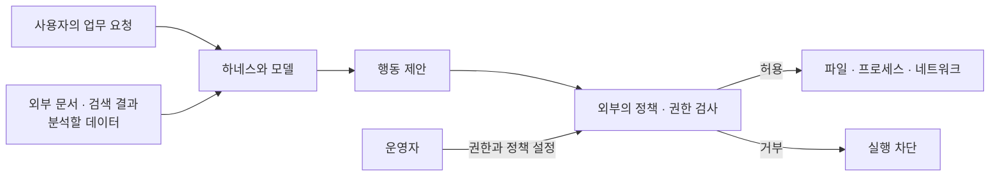
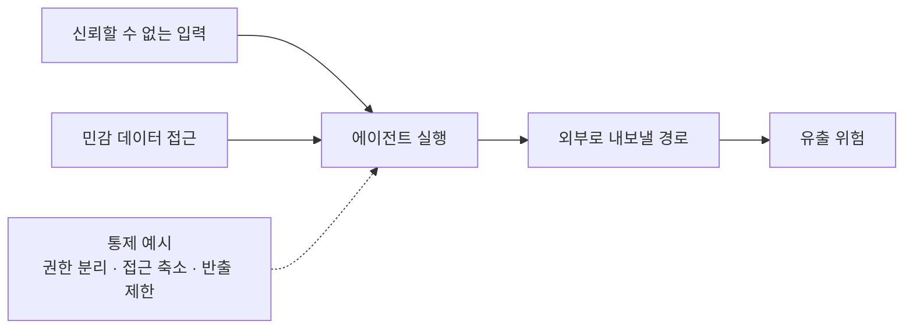
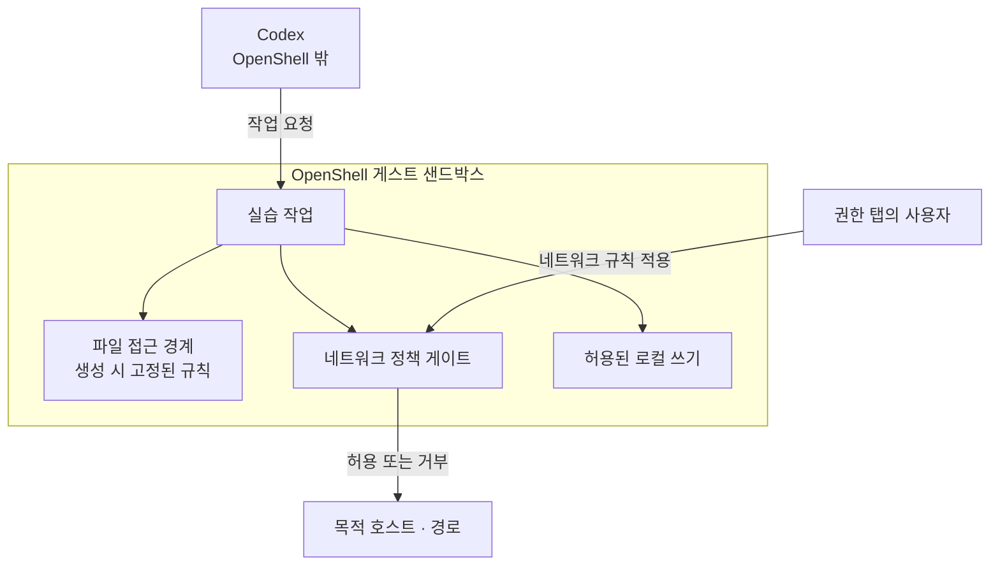
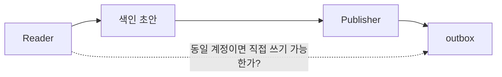

# 답변에 쓸 설명용 그림

이 문서의 자료별 이름과 번호는 내부 조회용이다. 사용자 답변에는 SKILL.md의 규칙에 따라 `근거: 강의 슬라이드 「주제」.`로 표기한다.
아래 그림은 원본을 복제한 것이 아니라 지정 장표에 근거한 재구성이다. 질문과 관계있는 그림 하나를 선택하고 그 아래에 근거와 한계를 붙인다. Mermaid를 지원하지 않는 환경에서는 같은 관계를 짧은 텍스트로 설명한다.

## 신뢰할 수 없는 데이터와 실행 권한

근거: 서울 30·53·99·127, 베를린 28·48·90·117.

핵심: 데이터를 읽는 것이 데이터에 명령 권한을 부여하는 것은 아니다. 이 그림은 모든 하네스가 이미 이 구조를 강제한다는 제품 보장이 아니라 목표 보안 구조를 설명한다.

## 치명적 삼요소와 연결 끊기

근거: 서울 53–54·89, 베를린 48–49.

핵심: 세 조건이 한 흐름에 결합되어 있는지 본다. 실습의 outbox는 반출 효과를 관찰하기 위한 학습용 목적지이며 실제 인터넷 유출이 관측되었다고 표현하지 않는다.

## 모듈 8의 OpenShell 범위

근거: DLI_codex/8.pdf 1~4페이지 및 강의 해당 장표. 실제 실습 절차는 PDF를 우선한다.

핵심: 네트워크 규칙으로 로컬 쓰기를 차단했다고 말하지 않는다. 강의에 표시된 200→403이나 EACCES는 해당 예시의 결과이며 사용자의 현재 실행 결과는 따로 확인한다.

## 역할 분리와 실제 권한 분리

근거: 서울 48·130, 베를린 102–103.

핵심: 점선이 실제로 거부되는지 권한으로 시험해야 한다. 작업 이름과 도구 목록만 나누는 것으로 파일 접근 권한이 분리되지는 않는다.
